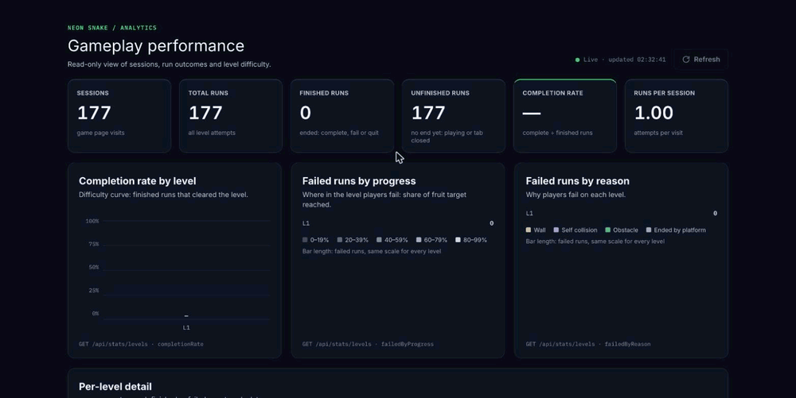
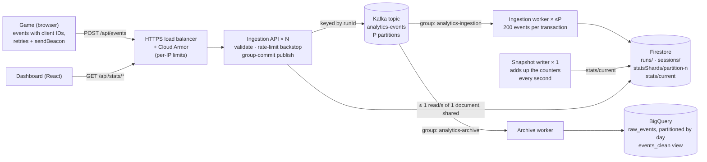

# Neon Snake

A browser game with a horizontally scalable analytics pipeline behind it. Every level attempt sends gameplay
events to an ingestion API; a queue, batched workers and sharded counters turn them into live statistics on a
dashboard, and a second consumer archives every raw event in BigQuery for analysis.

The game is small on purpose. Most of the work is the system around it: making ingestion **correct under
at-least-once delivery**, finding and removing each **write bottleneck in turn**, and **measuring** the result
with a load test that checks every event is counted exactly once.



*The dashboard during `pnpm load` at 150 events/s: every number arrives by push, no Refresh. The final totals
(823 sessions, 2,319 runs) equal exactly what the load test sent.*

**Stack:** TypeScript everywhere · Phaser 3 · Node.js, Express 5, Zod · Kafka (kafkajs) · Firestore ·
BigQuery · React 19 · Vitest · pnpm workspace · Terraform on Google Cloud (Cloud Run, HTTPS load balancer,
Cloud Armor)

## Highlights

* **Exactly-once results from at-least-once delivery.** Clients resend, queues redeliver, workers retry; the
  statistics still count each event once. Event IDs are made on the client, duplicates are found on the run
  record inside the same transaction that updates the counts, and offsets are committed only after a batch is
  stored.
* **Write path scaled bottleneck by bottleneck:** from about 8–10 events/s (Firestore's limit on 8 shared
  counter documents) to a queue, a batched worker that writes **up to 200 events per transaction** with **one
  counter document per partition**, no indexes on fields whose values only grow, and a group-committing
  producer.
* **Measured, not assumed.** A load test (`pnpm load`) found a real bottleneck in the Kafka producer: 503s at
  100 events/s. After the fix: **600 events/s with no errors (p50 4 ms)**, about **1,400 events/s per API
  process**, every event counted exactly once.
* **Live dashboard over Server-Sent Events:** one read loop per API instance pushes the statistics to every open
  dashboard, only when they change, so a thousand viewers cost the store what one does.
* **Cheap reads at any number of viewers:** statistics come from one precomputed snapshot document, one store read per second
  per instance at most, shared by concurrent requests, revalidated by the browser with ETags.
* **Layered protection:** Cloud Armor per-IP limits at the edge, in-process token buckets as the backstop,
  proxy-aware client IPs, origin checks, store deadlines shorter than the client's timeout, jittered retries.
* **One contract, three apps:** event and statistics types live in one workspace package, type-checked in the
  game, the backend and the dashboard; zod validates at runtime where data crosses a process boundary.

## Architecture



| Component | Role | Scales by |
| --- | --- | --- |
| Game client | Records `run_started` / `run_ended` per level attempt; resends with the same event ID | — |
| Edge | TLS, Cloud Armor per-IP rate limits; the only way in | managed |
| Ingestion API | Validates events, publishes them; serves statistics from cached counters | instances (stateless) |
| Kafka | Buffers bursts, orders each run's events (key = `runId`), lets consumers fail independently | partitions |
| Ingestion worker | Stores batches of events as runs and counters | one per partition |
| Archive worker | Keeps every raw event for analysis | one per partition |
| Snapshot writer | Adds up the counter documents into one snapshot document every second | one is enough; a second is harmless |
| Firestore | Runs, sessions, sharded statistics counters, the snapshot | documents (no hot spots) |
| BigQuery | Raw event archive for questions the counters cannot answer | managed |

Without `KAFKA_BROKERS`, the API stores events itself in the request: the same code path with a one-event
batch, which is simpler to run locally and fine at low traffic.

## Scaling the write path

Each step removed the bottleneck the previous one exposed.

| # | Bottleneck | Change | Effect |
| --- | --- | --- | --- |
| 1 | Statistics read every run on each request | Running counters updated in the same transaction as each event, spread over 8 shard documents | Reads cost 8 documents, however many runs exist |
| 2 | Firestore sustains about **1 write/s per document**, so 8 shared counters cap the system at **~8–10 events/s** | Queue + batched worker: one transaction per **200 events**, the batch's combined count change written once to **that partition's own counter document** | Counter writes grow with batches, not events; no two workers share a counter |
| 3 | 3–4 writes per event, one document per event only for finding duplicates | Duplicates found on the run record, which already holds its events' IDs | **1 read and 2–3 writes per event** instead of 2–3 reads and 3–4 writes |
| 4 | Firestore indexes every field; an indexed field whose values only grow (a time) caps a collection at **~500 writes/s** | Indexing turned off for every time field and the counters (`firestore.indexes.json`) | Cap removed; nothing queries those fields |
| 5 | Measured: the idempotent Kafka producer sends one request per broker at a time, so one send per HTTP request queued every post | **Group commit**: while a send runs, new events wait and go out together in the next | 503s at 100 events/s → **no errors at 600 events/s** |

The batch logic is a pure function shared by both stores, and a property test checks that saving events in
batches gives exactly the same results, runs and statistics as saving them one at a time, on generated data
mixed with resends and conflicts.

## Correctness under at-least-once delivery

Every hop can repeat a message, so each stage is idempotent rather than trying to deliver exactly once.

* **Identity at the source.** The game creates each event's ID once (132 random bits) and resends it
  unchanged. A run's first event fixes its session and level; a later event that disagrees is rejected as a
  conflict instead of overwriting data.
* **Duplicates and counts in one transaction.** The worker reads a batch's runs, applies the events in order,
  and writes runs, new sessions and the count change atomically. A duplicate changes nothing; a failed
  transaction leaves nothing behind.
* **Commit after store.** A partition's offsets move on only after its batch is stored. A failure brings the
  batch back, and its already-stored events are recognised as duplicates.
* **Poison messages can't block a partition.** Messages that can never be stored (not JSON, invalid, in
  conflict) are logged and skipped; store errors are retried.
* **Archive.** BigQuery rows carry the event ID as `insertId`, which drops most redeliveries; the
  `events_clean` view keeps one row per event for the rest.
* **Order independence.** A run's end may arrive before its start; merging gives the same run either way.

Verified end to end: under load with 5 % deliberate resends and retries, the statistics changed by exactly the
events sent; the archive turned 115,895 queued messages into exactly 115,895 rows (80,366 distinct events).

## Read path

* Statistics come from the running counters, so a read costs the same at 10 runs or 10 million.
* **One document per read:** a snapshot writer adds up the counter documents (8 random shards plus one per
  partition, so 56 with 48 partitions) into `stats/current` every second, and the API reads only that. The cost
  of a read stays flat as partitions are added. If the writer stops, a snapshot older than 10 s is ignored and
  the API adds up the counters itself: more reads, never wrong or missing answers.
* **1 s single-flight cache:** one read answers every statistics request for a second after it finishes, and
  requests arriving during a read wait for it. Firestore sees at most about one statistics read per second per
  instance, however many dashboards are open. Failed reads are not cached.
* **HTTP caching:** `Cache-Control: no-cache` with an ETag, so unchanged statistics come back as a body-less
  `304`. Everything else is `no-store`.

### Live updates

`GET /api/stats/stream` is a Server-Sent Events stream: the overview and the levels from one read, on connect
and whenever they change.

* **One loop per instance, not per viewer.** A broadcaster reads through the same cached service once a second,
  only while at least one stream is open, and sends a message only when the data changed (its ID is a hash of
  the data). Store reads stay the same at 1 viewer or 1,000; only the outgoing messages grow.
* **Reconnects without resending.** Browsers reconnect dropped streams by themselves and send the last message
  ID back; if nothing changed, nothing is resent. A keep-alive comment every 20 s keeps proxies from closing
  quiet streams.
* **Bounded.** Opening a stream counts against the per-IP read limit; at most 5 open streams per IP (`429`) and
  1,000 per instance (`503` with `Retry-After`). On shutdown, every stream is ended first, so it never holds the
  process open.
* **Degrades to manual.** If the store fails, the stream sends one `unavailable` event and stays open; the next
  good read recovers it. If the server refuses the stream, the dashboard falls back to **Refresh** and tries live
  again 30 s later. An answer to a Refresh started before a push is dropped, so the page never goes back to
  older data.
* **Why SSE:** the data flows one way, and SSE is plain HTTP through the load balancer and Cloud Armor, with
  reconnection built into browsers. WebSockets would add a protocol and state for nothing; polling would cost a
  request per viewer per interval.

Statistics are therefore at most about 2 s old (snapshot plus cache), and Firestore sees about one one-document
read per second per API instance, whatever the number of viewers. At 10 instances that is ~0.9 million document
reads a day for the statistics, instead of ~48 million when every read adds up 56 counter documents.

## Protecting the system

| Layer | Mechanism |
| --- | --- |
| Edge | Cloud Armor throttles each client IP on events, statistics and health (`429`); the API only accepts traffic from the load balancer, so the limits can't be bypassed |
| API | Token bucket per client IP as the backstop (events: burst 60, 1/s; reads: burst 30, 2/s), split across instances with `API_INSTANCES`; client IP from `X-Forwarded-For` only through `TRUST_PROXY` hops (`true` is refused, as it would let clients pick their IP) |
| Requests | Origin allowlist with a `403` for other origins (CORS alone does not stop `sendBeacon` posts); 100 kB body limit; at most 50 events per request; security headers via helmet |
| Dependencies | Store and broker calls get a 3 s deadline, below the client's 5 s timeout, so clients get a `503` they can retry instead of hanging |
| Clients | Exponential backoff to 30 s with ±20 % jitter, spread so clients at the cap do not retry together; `Retry-After` honoured |
| Shutdown | Graceful: stop accepting, finish in-flight requests, cut off after 10 s; workers leave their consumer group so partitions move at once |

## Capacity

Measured on one laptop (Firestore emulator, one API process, one worker, 3 partitions, load generator on the
same machine), with `pnpm load`:

| Path | Events/s | Result |
| --- | --- | --- |
| Direct to Firestore | 300 | every event counted exactly once, but 2,170 posts timed out and were retried; p95 6.5 s |
| Direct to Firestore | 600 | collapses |
| Kafka, one send per post | 100 | 1,095 × `503`: posts queued behind the producer |
| Kafka, group commit | 600 | no errors, p50 4 ms, p99 470 ms, worker keeps up live |
| Kafka, group commit | 1,500 | every event counted exactly once, p50 114 ms; one API process near its limit |
| Reads: 1,000 dashboards, no writes | ~900 req/s | all `200`, p50 1 ms, p99 22–30 ms, with or without the snapshot (the 1 s cache absorbs them) |
| Reads and writes: 1,000 dashboards + 300 events/s | ~900 + 300 req/s | every event counted exactly once; every read `200`; no dashboard ever saw the numbers go backwards; read p99 595 ms sharing one process |

The snapshot does not change what viewers see in latency: the cache already keeps Firestore at about one read
per second. It changes the cost of that read, from every counter document to one.

The emulator enforces none of Firestore's limits, so these numbers describe the API, Kafka and the worker,
not Firestore itself. **Estimate** for 10,000 events/s (about 300,000 concurrent players, two events per
one-minute run):

* **API:** ~1,400 events/s per process measured with one event per request, so 8–10 instances with headroom.
* **Kafka:** 48 partitions → ~210 events/s each; one 200-event transaction per second per partition counter
  document, at Firestore's sustained rate per document.
* **Firestore:** ~10,000 run writes/s plus new sessions, spread over random document IDs; reached gradually
  (Firestore's 500/50/5 ramp-up: start at 500 ops/s, +50 % every 5 minutes).
* **BigQuery:** ~3 MB/s, ~250 GB/day of raw events, 90-day partition expiry.

## Analytics archive

The counters answer "what is happening now". Questions over time (trends, before and after a level change,
how far players get in a session) need the raw events. The archive worker reads the topic in its own consumer
group, so archiving never slows down storing, and writes each event to `neon_snake.raw_events`: partitioned
by day of `occurredAt`, clustered by type and level, partition filter required so queries stay cheap. Locally
it writes one NDJSON file per day in the same shape. A test keeps the table schema and the archived rows equal.

## Deployment

`infra/` holds the Google Cloud setup as Terraform: HTTPS load balancer, Cloud Armor policy, the API and both
workers on Cloud Run with their own service accounts, the Firestore field settings, and the BigQuery dataset
and table. A `Dockerfile` builds one backend image; the command picks the API or a worker. The configuration
validates but has not been applied; see [`infra/README.md`](infra/README.md) for what comes first.

## The game and its analytics client

* Three levels of increasing difficulty, fruit and scoring, keyboard, swipe and on-screen controls, pause,
  retry and level selection, persistent best score and mute, procedural sound.
* **Famobi GameInterface SDK**, kept behind a small `GamePlatform` interface so the game also runs without it:

  | Moment | SDK |
  | --- | --- |
  | Loading | `init()`, preload progress, `gameReady()` |
  | Level start | `gameStart(level)` |
  | Level end | `sendScore()`, `gameEnd()` |
  | Final level | `gameFinished()` |
  | Fruit collected | `sendScore()`, `sendProgress()` |
  | Pause / resume | `gamePause()`, `gameResume()` |
  | Mute | `gameMuted()` |

  The game waits for the SDK's promises before it continues and runs one command at a time, so platform
  events (pause, mute, restart, quit, level navigation) never cause conflicting transitions.
* **Analytics client:** each level attempt is a run with two events, sent at once and kept until the backend
  answers. Network errors, timeouts, `408`, `429` and `5xx` are retried with backoff; pending events go out with
  `sendBeacon` when the page is hidden or closed. A session is one page load: no personal data and no
  persistent player ID.
* **No service worker:** games like this usually run in an iframe on a portal, where service workers are
  often blocked or partitioned, and Background Sync is Chromium-only. `sendBeacon` covers page exit; the
  remaining loss (a page closed while offline) does not change aggregate statistics.

## Dashboard

React app showing sessions, runs, completion rate and runs per session, plus three graphs that each answer one
question: how hard is each level (completion rate), where players fail (progress), and why (failure reason).
Completion rate is complete ÷ finished runs; unfinished runs are shown separately. Data arrives **live**
(● Live · updated HH:MM:SS) and falls back to loading on open and on **Refresh** when the stream is
unavailable; loading, empty, refreshing and backend-error states are handled, and all formatting lives in one
tested function.

## Repository

```text
neon-snake/
├── game/              # Phaser game, Famobi SDK adapter, analytics client
├── backend/           # Ingestion API, ingestion and archive workers, load test (API.md documents the API)
├── dashboard/         # React dashboard
├── packages/contract/ # Event and statistics types and zod schemas shared by all three
├── infra/             # Terraform for Google Cloud, BigQuery table
├── openspec/          # Specifications and design plans
└── .github/           # CI: check, test and build every project
```

One pnpm workspace with a single lockfile. The backend uses ports and adapters (HTTP → services → store and
queue interfaces → Firestore, Kafka and BigQuery adapters), so every layer is tested on its own with in-memory
or fake adapters.

## Run locally

Requirements: Node.js 22.13+, pnpm 11, Java 21+ (Firestore emulator), Docker (only for Kafka). No cloud account
is needed: the backend runs against the local Firestore emulator with a `demo-` project and refuses anything
else.

```bash
nvm use 22 && pnpm install          # once, from the repository root
pnpm emulators                      # terminal 1: Firestore emulator (data UI on http://localhost:4000)
pnpm dev                            # terminal 2: API :3000, game :5173, dashboard :5174
pnpm seed                           # optional: demo gameplay, so the dashboard has data at once
```

`pnpm dev` points the game at the API, so playing a level and clicking **Refresh** on the dashboard shows it.
Running the game on its own (`pnpm --filter ./game dev`) needs `game/.env.example` copied to `game/.env.local`.

**With Kafka**, run the game and dashboard on their own and, in `backend/`, these instead of the API:

```bash
pnpm kafka        # one broker in Docker on 127.0.0.1:9092
pnpm dev:kafka    # API publishing to the queue
pnpm worker       # stores queued events in batches
pnpm archive      # optional: raw events to backend/archive-data/*.ndjson
pnpm snapshot     # optional: the statistics snapshot, so a read costs one document
```

`ARCHIVE=bigquery BIGQUERY_PROJECT=<project>` streams to BigQuery instead; as that is a real project, it runs
only when asked for.

| Problem | Fix |
| --- | --- |
| `node:sqlite` or "requires at least Node.js v22.13" | Run `nvm use 22` in that terminal |
| Java error when starting the emulator | `export PATH="$(brew --prefix openjdk@21)/bin:$PATH"` |
| Dashboard shows "Offline" | Start the backend, then click **Retry** |
| Played, but the dashboard does not change | Click **Refresh**; a game started on its own needs `.env.local` before it starts |

## Testing

`pnpm check`, `pnpm test` and `pnpm build` at the root run in every project; CI runs them on every push and
pull request, plus the Firestore emulator tests.

| Project | Tests |
| --- | --- |
| `packages/contract` | 35 |
| `game` | 77 |
| `backend` | 183, plus 17 against the real Firestore emulator (`pnpm test:emulator`) |
| `dashboard` | 85 |

Notable tests: batch-equals-one-by-one on generated data with resends and conflicts; Kafka chunking with
offsets resolved only after storing; group-commit ordering and failure; cache single-flight and expiry;
proxy-aware rate limits; the archive schema matching the BigQuery table; the game's real events passing the
backend's validation; the backend's statistics matching the dashboard's schemas exactly; a fake Famobi SDK
checking call order and that the game waits where the SDK requires.

**Load test** (in `backend/`, against a running API started with `TRUST_PROXY=1`):

```bash
LOAD_EVENTS_PER_SECOND=600 LOAD_SECONDS=20 pnpm load
LOAD_READERS=1000 LOAD_EVENTS_PER_SECOND=300 pnpm load   # 1,000 dashboards polling meanwhile
```

Each simulated player posts each event in its own request from its own client IP, a share of events is resent,
failures are retried with the game's backoff, and the run passes only if the statistics changed by exactly the
events sent. With `LOAD_READERS`, that many dashboards poll both statistics routes from their own IPs, and the
run also fails if any read errors or any dashboard sees the numbers go backwards.

## Limitations and roadmap

* **Production opt-in.** The backend refuses a real Firestore by design; deploying needs a deliberate switch.
* **Managed Kafka** on Google Cloud needs SASL authentication in the Kafka client.
* **Verify the client IP** behind the load balancer after the first deploy (`TRUST_PROXY=2`).
* **Load test against real Firestore**, to confirm the per-document and ramp-up numbers above.
* **Authentication** on the event endpoint.
* **Closed tabs** stay `unfinished`; a timeout could turn them into their own outcome.
* **Schema version 2** with game version and platform, so trends can be split by release and device.
* **Daily summary tables** in BigQuery built from `events_clean`, and a trends view on the dashboard.
* Live updates send the overview and levels from one read; the Refresh fallback still makes two requests, so
  its totals can differ by one run while someone plays.
* "Play again" after the last level sends `gameStart` after `gameFinished`, which Famobi's local tester reports
  as invalid.

## Credits

The game began from Famobi's MIT-licensed snake starter (see `LICENSE`); the SDK integration, analytics
pipeline, backend, dashboard, infrastructure and tests were built on top of it. Built with Claude Code; the
dashboard's visual reference was made with Claude Design, and the design plans are in `openspec/`.
